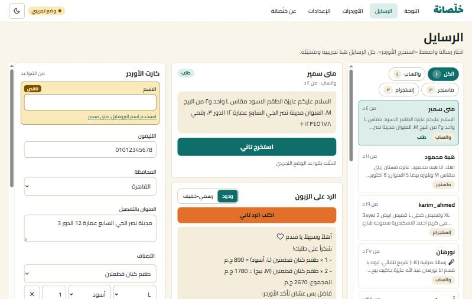
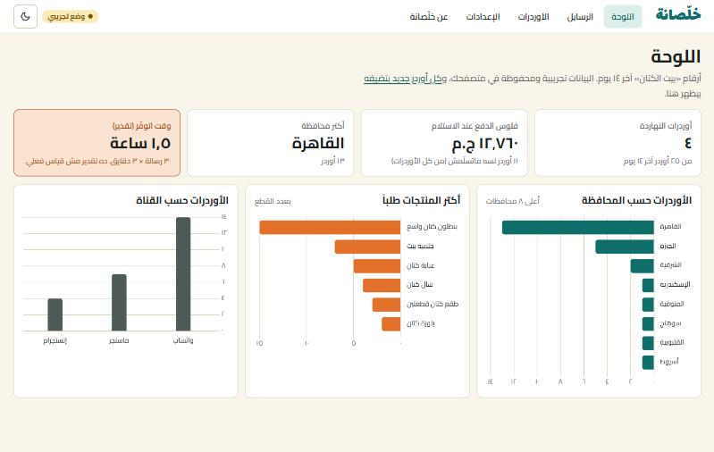
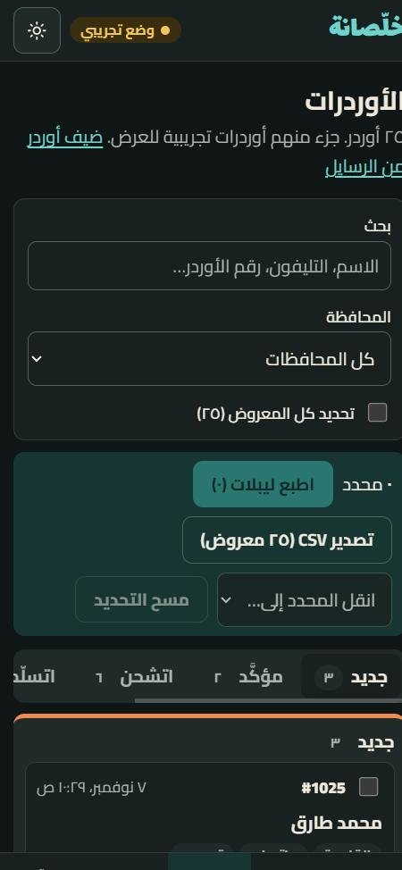

# Khalsana | خلّصانة

**Customer messages in. Orders out, sorted.**
«رسايل الزباين تدخل… والأوردرات تطلع خلّصانة.»

An AI tool for Egyptian online sellers. It reads messy customer messages in Egyptian Arabic from WhatsApp, Messenger and Instagram, turns them into clean orders, drafts the reply, and prints the shipping labels.

**Live demo:** https://khalsana-ai.vercel.app



| Dashboard | Orders board (phone, dark mode) |
|---|---|
|  |  |

## The problem (case study)

Small Egyptian brands sell through chat. Orders arrive like this:

> عايزة الطقم الاسود مقاس L واحد و٢ من البيج M، العنوان مدينة نصر الحي السابع عمارة ١٢ الدور ٣، رقمي ٠١٠١٢٣٤٥٦٧٨

Someone copies every message into a spreadsheet by hand, works out the shipping fee for the governorate, asks again for missing details, and writes labels. That's about **3 minutes per message**, with typos in phone numbers and addresses.

## The solution

1. **Extract:** one click turns the message into a structured order: customer name, phone (normalised to `01XXXXXXXXX`), governorate (from area names like «مدينة نصر» → القاهرة), address, and items matched to the real catalog (product, size, colour, quantity). Missing or low-confidence fields are highlighted.
2. **Reply:** an Egyptian-dialect reply is drafted. It confirms the order and the cash-on-delivery total, or asks only for what's missing, or answers a price question. Out-of-stock items are flagged, and the reply offers alternatives. One click opens it in WhatsApp.
3. **Ship:** move orders across a board (جديد → مؤكَّد → اتشحن → اتسلّم → مرتجع), print A6 shipping labels with Code128 barcodes, and export to Excel-ready CSV.

The analytics dashboard shows cash on delivery to collect, top governorates and products, orders per channel, and an estimate of the time saved.

## How the AI is built

- **Server-side only:** the browser calls the app's own API routes, and only the server talks to [Groq](https://console.groq.com). The API key never reaches the browser.
- **Structured output:** the model must return strict JSON, and the server **validates it against the catalog and the rules** before showing it. Unknown products are dropped, quantities are clamped, and the phone must actually appear in the message. The model is never trusted blindly.
- **Prompt-injection aware:** customer text and store settings are passed to the model as data, never as instructions.
- **Works without AI:** a rule-based Egyptian-Arabic extractor (Arabic-Indic digits, Franco-Arabic, area dictionary for all 27 governorates, product/colour/size spelling variants) runs when no key is set or the free limit is reached. The demo always works, at $0.
- **Abuse protection:** same-origin check, input size limits, per-IP and global rate limits, timeouts, security headers.

## Tech stack

- Next.js 15 (App Router) + React 19
- Groq API (free tier, `openai/gpt-oss-120b`) through plain `fetch`, no SDK
- Chart.js via react-chartjs-2
- Hand-written Code128 barcode encoder (SVG) and CSV export (UTF-8 BOM for Excel)
- Fonts: Cairo + Lalezar via `next/font`
- Hosted on Vercel (free)

## Run locally

Needs Node.js 18.18+. In PowerShell:

```powershell
npm install
npm run dev
```

Open http://localhost:3000. Without a key, the app runs in demo mode (وضع تجريبي).

For live AI, get a free key at https://console.groq.com (no credit card), then create `.env.local` in the project folder:

```
GROQ_API_KEY=your_key_here
GROQ_MODEL=openai/gpt-oss-120b
```

`.env.local` is ignored by git. Never commit your key.

## Deploy on Vercel (free)

1. Import this repo at https://vercel.com/new.
2. Optional: add `GROQ_API_KEY` in **Settings → Environment Variables**, then redeploy.
3. Recommended: set a usage limit in the Groq console. On the free tier with no card, it can't cost money.

## Notes

«بيت الكتان», its products, customers and orders are fictional demo data, stored only in your browser. Pricing and testimonials are samples.
